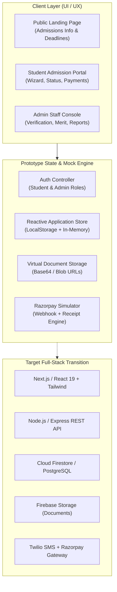
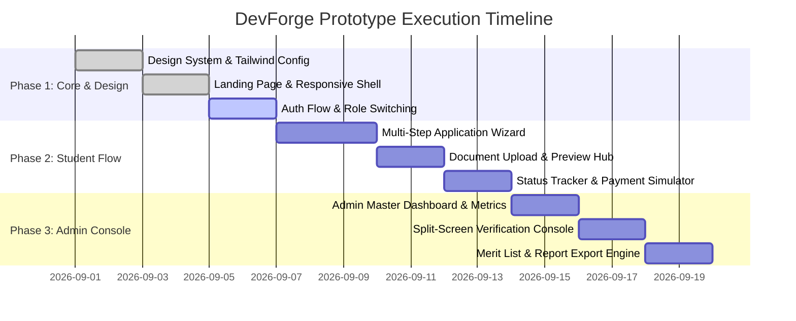

# 🎓 IEM Admission System — Prototype & Architecture Plan
**Department of Computer Science & Engineering | Institute of Engineering & Management (IEM), Kolkata**  
*Course: PCCCS504 (Software Engineering & Project Management) | Team: P4 ("DevForge")*  
*Document Version: 1.0.0 | Date: August 2026 / 2026 Academic Year*

---

## Executive Summary & Vision

The **IEM Admission System** is a next-generation, high-performance web platform designed to eliminate manual, paper-intensive admission workflows at IEM Kolkata. It bridges prospective students with the admission committee through a transparent, automated, and secure digital pipeline—spanning account registration, multi-step application drafting, instant document verification, automated merit computation, seat allotment, online fee collection via payment gateway, and generation of verified Student IDs and admission letters.

This document outlines the **enhancements to the initial SRS and system diagrams**, establishes the **"Indigo Harbor" design system**, and provides an actionable **step-by-step blueprint to build an interactive, high-fidelity prototype**.

---

## 1. Enhancements Over Base SRS & Diagrams ("What We Cooked Up")

Based on analysis of the original SRS, Activity, Sequence, Class, and Wireframe diagrams, the following critical upgrades have been integrated to elevate the system from a basic form-fill portal to an enterprise-grade academic admission platform:

```
┌────────────────────────────────────────────────────────────────────────────────────────┐
│                                SYSTEM EVOLUTION                                        │
├─────────────────────────────────────┬──────────────────────────────────────────────────┤
│ Original Baseline                   │ Upgraded DevForge Prototype Specification        │
├─────────────────────────────────────┼──────────────────────────────────────────────────┤
│ • Basic single-page form            │ • 4-Step Guided Wizard with Autosave Drafts      │
│ • Simple Approve / Reject decision  │ • 8-State Application Lifecycle & Audit Log      │
│ • Blind document upload             │ • Document Checklist with Live In-Browser Preview│
│ • Manual verification bottleneck    │ • Split-Screen Fast Verification for Admins      │
│ • Generic status label              │ • Visual Timeline Tracker with Query Resolution   │
│ • Static admin list                 │ • Real-time Filterable Kanban & Data Grid        │
│ • Rudimentary wireframe             │ • "Indigo Harbor" shadcn-grade UI with Stats Bar │
└─────────────────────────────────────┴──────────────────────────────────────────────────┘
```

### 1.1 Robust 8-Stage Application Lifecycle State Machine
Instead of a simple binary approve/reject, the admission journey follows a resilient Finite State Machine:
1. `DRAFT`: Student editing personal, academic, and document details.
2. `SUBMITTED`: Form finalized, timestamped, and assigned a unique Application No. (`IEM-2026-XXXX`).
3. `UNDER_REVIEW`: Locked for student editing; assigned to an Admission Officer.
4. `ACTION_REQUIRED (QUERY)`: Officer flags specific discrepancy (e.g. *"12th Marksheet blurry"*); student notified with inline re-upload button.
5. `VERIFIED_ELIGIBLE`: Academic criteria validated (e.g. PCM $\ge$ 60% and valid WBJEE/JEE rank).
6. `SEAT_OFFERED`: Course allotted based on preference and merit cut-off; fee payment window opened.
7. `ADMISSION_CONFIRMED`: Fee successfully processed via payment gateway; Student ID and Confirmation Slip generated.
8. `WAITLISTED` / `REJECTED`: Clear transparent feedback with optional round 2 consideration.

### 1.2 Interactive Query Resolution Loop (Fixes FR-17)
Applicants can communicate directly with the verification committee on flagged items through a contextual chat/thread attached to specific fields or documents without invalidating the entire application.

### 1.3 Split-Screen Admin Verification Console
Replaces clunky document downloading. Admission officers view submitted student marks and personal details on the left, with an embedded high-resolution document viewer on the right, featuring one-click verify/flag controls.

### 1.4 Automated Merit Index Calculator & Quota Tracker
Real-time seat capacity tracker across engineering departments (CSE, IT, CSBS, AI&ML, ECE) with automatic merit score calculation based on 10th %, 12th PCM %, and JEE/WBJEE percentiles.

### 1.5 Instant Digital Deliverables
- **Application Summary PDF** upon submission.
- **GST-compliant Payment Receipt** upon fee settlement.
- **Provisional Admission Letter** with QR Code verification for campus onboarding.

---

## 2. Design System & UI Specification: "Indigo Harbor"

Incorporating the design tokens and visual language from the provided design guidelines and Voltway-inspired aesthetic:

### 2.1 Color Palette & Theme Tokens
```css
:root {
  /* Brand Primary */
  --primary: #1E3A8A;            /* Deep Harbor Blue - Primary Brand, Headers, Active States */
  --primary-hover: #1D4ED8;      /* Royal Indigo - Hover States */
  --primary-light: #EFF6FF;      /* Soft Ice Blue - Badges, Selected Backgrounds */

  /* Neutral & Dark */
  --secondary: #0F172A;          /* Deep Slate / Midnight - High contrast secondary buttons */
  --secondary-hover: #1E293B;

  /* Accent & Action */
  --accent: #2563EB;             /* Electric Blue - Links, active indicators, focus rings */
  --destructive: #991B1B;        /* Crimson Red - Errors, Rejection, Delete alerts */
  --destructive-light: #FEF2F2;

  /* Semantic Status Colors */
  --success: #059669;            /* Emerald Green - Verified, Approved, Paid */
  --success-light: #ECFDF5;
  --warning: #D97706;            /* Amber Gold - Under Review, Query Pending */
  --warning-light: #FFFBEB;

  /* Surfaces & Borders */
  --background: #F8FAFC;         /* Clean Ultra-light Slate Page Background */
  --card: #FFFFFF;               /* Crisp Pure White Surface */
  --card-border: #E2E8F0;        /* Subtle Border for Cards and Dividers */
  --muted: #64748B;              /* Slate Muted Text for secondary labels */
  --muted-bg: #F1F5F9;           /* Soft Muted Pills & Table headers */

  /* Form & Radii */
  --radius: 0.5rem;              /* 8px radius across cards, inputs, buttons */
}
```

### 2.2 Typography & Spacing Hierarchy
- **Font Family**: `'Inter', system-ui, -apple-system, sans-serif`
- **Headings**:
  - `Display 1`: 36px / 44px line-height, bold (Landing hero, Dashboard headline)
  - `Heading 2`: 24px / 32px line-height, semi-bold (Section headers, Modal titles)
  - `Heading 3`: 18px / 26px line-height, semi-bold (Card titles, Form groups)
- **Body**: 14px / 20px line-height, regular/medium (Table data, input fields, labels)
- **Captions / Badges**: 12px / 16px line-height, medium uppercase or pill formatting

### 2.3 Component Archetypes (shadcn/ui Inspired)
- **Buttons**:
  - `Primary`: Solid Deep Harbor Blue (`#1E3A8A`), white text, 8px radius, subtle elevation shadow.
  - `Secondary`: Solid Midnight Slate (`#0F172A`), white text.
  - `Outline`: Border `1px solid #E2E8F0`, transparent background, dark text, hover light slate.
  - `Ghost`: Minimalist icon buttons with hover background `#F1F5F9`.
  - `Destructive`: Crimson solid or soft red pill with red text.
- **Metric Cards (Voltway Inspired)**:
  - White surface, subtle 1px border, large bold stat counter (`24/7`, `99.4%`, `1,250+ Applicants`), caption label beneath.
- **Status Badges**:
  - Rounded pill format (`px-3 py-1 text-xs font-semibold rounded-full`) with tinted backgrounds (`bg-amber-50 text-amber-700 border border-amber-200`).

---

## 3. System Architecture & Tech Stack



---

## 4. Key Deliverables & Wireframe Specifications 2.0

### Deliverable A: Public Admissions Landing Page (Voltway Inspired)
- **Hero Section**: Clean badge ("🎓 2026-2027 B.Tech Admissions Open"), strong bold heading: *"Shape Your Engineering Future at IEM Kolkata"*, dual CTA buttons (`Apply Now` / `Track Application`).
- **Live Metrics Ribbon**:
  - `5+` Specializations (CSE, IT, CSBS, AI&ML, ECE)
  - `100%` Placement Assistance
  - `15,000+` Alumni Worldwide
  - `₹72 LPA` Highest Package Offered
- **Important Dates Timeline**: Phase 1 cutoff dates, counseling schedule, seat availability alerts.
- **Quick Eligibility Checker Widget**: Input 12th % and rank to instantly check department eligibility before starting application.

### Deliverable B: Student Admission Portal
1. **Authentication Screen**:
   - Single portal with intuitive toggle: `[Student Login / Register]` & `[Admin Portal]`.
   - Google / Email + Password login with demo credentials pre-filled for one-click testing.
2. **Multi-Step Application Wizard**:
   - **Step 1: Personal & Guardian Details**: Full Name, DOB, Phone, Email, Guardian info, Permanent Address.
   - **Step 2: Academic Qualifications**: 10th Board, School, Year, %; 12th Board, Physics, Chemistry, Math marks, aggregate %; Entrance Exam (JEE Main / WBJEE Roll & Rank).
   - **Step 3: Program Preferences**: Drag-and-drop or priority select (1st, 2nd, 3rd choice: CSE, CSE-AIML, IT, ECE, CSBS).
   - **Step 4: Document Uploads**:
     - Slot 1: Passport Size Photo (JPG/PNG, max 2MB)
     - Slot 2: Class 10 Admit Card / DOB Proof (PDF/JPG)
     - Slot 3: Class 12 Marksheet (PDF/JPG)
     - Slot 4: JEE Main / WBJEE Rank Card (PDF)
     - Each slot features drag-and-drop, thumbnail preview, file validation, and clear status.
   - **Step 5: Review & Final Submission**: Read-only summary cards with edit jump links and declaration check.
3. **Application Tracking & Payment Hub**:
   - Progress Stepper: `Submitted` ➜ `Documents Verified` ➜ `Merit Listed` ➜ `Seat Allotted` ➜ `Enrolled`.
   - Real-time Alert Banner: Any officer query shown prominently with reply box.
   - **Interactive Razorpay Checkout Simulator**: Displays breakdown of admission fees (Tuition, Lab, Caution Deposit), one-click simulated payment, instant invoice download.

### Deliverable C: Admin Staff Verification Dashboard
1. **Command Center Overview**:
   - Metric cards: Total Applications, Pending Verification, Queries Open, Confirmed Admissions, Total Fee Collected.
2. **Applications Master Table & Kanban**:
   - Search bar (Filter by Application #, Name, Rank, Stream).
   - Multi-filter dropdown (Stream, Status, Date).
   - Action buttons: Quick Review, Export CSV, Bulk Approve.
3. **Split-Screen Verification Suite**:
   - Left Panel (50%): Student profile, academic scores, computed PCM aggregate, preference list.
   - Right Panel (50%): In-browser document viewer with zoom/rotate controls.
   - Action Bar:
     - `Approve & Verify` (Marks student eligible).
     - `Raise Query` (Specifies document and reason; triggers instant alert to student).
     - `Offer Seat` (Assigns allocated branch).
4. **Merit List & Seat Allocation Engine**:
   - Real-time ranked list generation based on merit criteria.
   - Quota capacity tracker with visual progress bars per department.

---

## 5. Prototype Implementation Plan & Milestones

The prototype is structured to be delivered in **3 agile phases**:



### Detailed Milestone Deliverables:

| Phase | Milestone | Deliverables | Acceptance Criteria |
| :--- | :--- | :--- | :--- |
| **Phase 1** | **Foundations & Design System** | • `index.html`, modern CSS variables for "Indigo Harbor"<br>• Header, Navigation, and Public Landing Page<br>• Role-based Auth Mock (Student & Admin) | • Zero broken layouts on desktop & mobile.<br>• Clean switching between Student and Admin views.<br>• Passes contrast accessibility standards. |
| **Phase 2** | **Student Portal Experience** | • 5-step Application Form with validation<br>• LocalStorage draft persistence<br>• Multi-file upload simulator with preview<br>• Simulated Razorpay payment popup with receipt | • User can fill all 5 steps and submit.<br>• Generates unique ID `IEM-2026-XXXX`.<br>• Document formats validated before preview. |
| **Phase 3** | **Admin Console & Verification** | • Admin dashboard with metrics<br>• Split-screen verification modal<br>• Query send & resolve mechanism<br>• Merit list generator and CSV export | • Admin can review, verify documents, and raise query.<br>• Status change immediately updates student portal.<br>• Export button downloads valid CSV report. |

---

## 6. Project Charter (Academic Submission Format)

*Prepared for Faculty In-Charge: Prof. Saikat Dutta & Prof. Partha Chakraborty*

| Charter Section | Specification Details |
| :--- | :--- |
| **Project Title** | **IEM Online Admission System (DevForge)** |
| **Scope Overview** | Design and engineer a responsive web-based admission management prototype that streamlines student application intake, digital document verification, payment processing, and administrative merit listing for IEM Kolkata. |
| **Milestone Schedule** | • **Week 1–2**: Requirements finalization & Design System implementation.<br>• **Week 3–4**: Student portal, application wizard & document uploader.<br>• **Week 5–6**: Admin verification console, query loop & payment simulator.<br>• **Week 7**: Testing, bug fixes, faculty demo & lab report submission. |
| **Acceptance Criteria** | 1. 100% test coverage of all 20 Functional Requirements (FR-1 through FR-20).<br>2. Flawless execution of the Student Application ➜ Verification ➜ Payment ➜ Enrollment lifecycle.<br>3. UI strictly adheres to the "Indigo Harbor" shadcn-grade aesthetic with zero default browser styling. |
| **Risks & Constraints** | • **Data Privacy**: Student records must be secured with simulated RBAC.<br>• **Schedule**: Completion within academic semester deadlines (by Nov 2026).<br>• **Dataset**: Synthetic applicant records used to safeguard actual student confidentiality. |
| **Team Operating Principles**| 1. Clear division of modules across team members (Frontend, Admin Console, State/API, Documentation).<br>2. Cloud code repository with automated build checks.<br>3. Weekly syncs and peer code review prior to milestone submissions. |

---

## 7. Next Steps for Immediate Execution

1. **Review and approve this Prototype Plan**.
2. **Execute Phase 1 & 2**: Spin up the interactive prototype web application directly in the workspace containing:
   - High-fidelity Public Landing Page.
   - Complete Student Application Wizard with realistic document uploads.
   - Interactive Admin Verification Console with split-screen review.
   - Razorpay Payment Simulation and instant Admission Letter generator.
